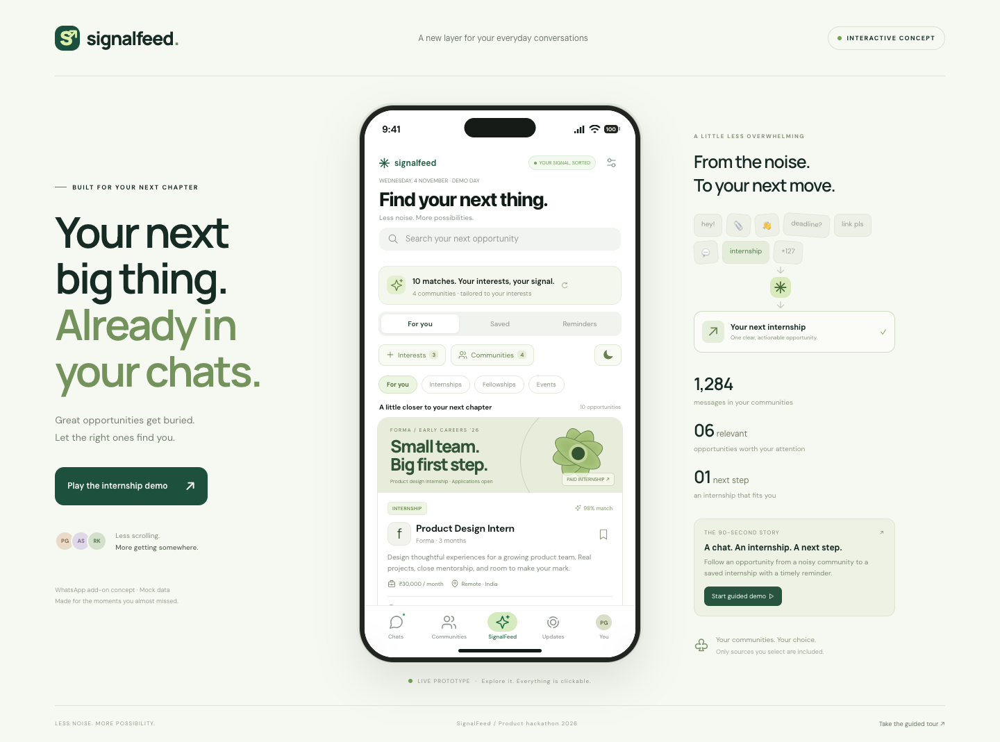

# SignalFeed

**Never miss an opportunity hidden in a conversation.**

SignalFeed is a WhatsApp-inspired product hackathon prototype that turns selected community announcements into a personalized feed. It includes an iOS WKWebView app, a responsive browser experience, dark mode, and a guided internship demo.



## Run locally

Requires **Node.js 22 or newer** and npm.

```bash
git clone https://github.com/gautampartha/SignalFeed.git
cd SignalFeed
npm install
npm run dev
```

Open **http://localhost:5180**. On macOS, you can also double-click **Start Demo.command**. To start the guided presentation immediately, open **http://localhost:5180/?demo**.

On a phone connected to the same Wi-Fi as your computer, use the Network URL printed by Vite. Keep the computer and development server running. The native iOS app bundles its assets and does not require the development server.

## Explore the app

- **Chats:** populated conversations, community discussions, local replies, and search.
- **Communities:** six populated communities with **11 distinct group threads**. Groups contain multiple announcements, paid internships, sports events, workshop details, and conversations. Switch between groups using the tabs inside a chat. Each group keeps its own replies.
- **SignalFeed:** a personal feed using only communities and interests you explicitly select. Save opportunities, inspect eligibility and stipends, follow the original message, and set deadline reminders.
- **Updates:** a sample daily digest and community highlights.
- **You:** interests, saved items, reminders, appearance, guided demo, and local data reset.

### Personalize your feed

1. Open **SignalFeed → Interests**. Choose a suggestion or select **Add your own** and type a topic.
2. Open **Communities** inside SignalFeed and add only the sources you want to follow. Other communities remain excluded.
3. For a sports example, select **Sports** and **Campus Sports Club**. You’ll see football, badminton, and a sports management internship.
4. To see paid roles, select **Internships** and add **VIPS Career Connect**, **TECH UNBOUND ’26**, or another career community.
5. Use **Add your own demo community** to enter a community name, topic, and sample announcement.

**All communities start excluded from SignalFeed.** Browsing a community chat does not add it to the feed. Custom interests, source selections, saved items, reminders, replies, and appearance persist locally. Previously saved opportunities remain available even if you later remove their source from your feed.

Tap the **moon/sun button** in SignalFeed or **You → Dark mode** to switch appearance. The native status bar follows the selected theme.

## Mock communities and content

There are **15 built-in opportunities: 10 paid internships, one fellowship, and four events**.

| Community | Example content |
| --- | --- |
| TECH UNBOUND ’26 | Product design, frontend and backend internships; product hackathon discussion |
| Design Circle | Product design, UX research and visual design roles; fellowship and portfolio clinic |
| VIPS Career Connect | Engineering, marketing and operations internships; peer referrals |
| HackVerse 2.0 | Data analytics internship, research role, portfolio workshop and build discussion |
| Campus Sports Club | Football cup, badminton doubles, sports management internship and matchday plans |
| Delhi Runners & Racquets | Community 5K, badminton, fitness internship and weekend meet-up |

Group chats remain populated whether or not you add them to SignalFeed. Shared opportunities reuse one ID so a feed can consolidate their source references.

## Presentation demo

Click **Play the internship demo** on desktop or **You → Play the internship demo** on mobile. The seven-step flow follows a Product Design Internship at fictional company Forma:

**Busy inbox → original announcement → simulated extraction → opportunity card → saved shortlist → reminder → calendar export.**

The guided demo temporarily uses sample sources and restores your personal community and interest selections afterward.

- [90-second pitch script](demo/PRESENTATION.md)
- [Recorded internship walkthrough](demo/internship-demo.webm)
- [Browser and native verification notes](demo/VERIFICATION.md)
- [Dark mode preview](demo/iphone-dark-personalization.png)

The demo date is fixed to **4 November 2026**. All deadlines use **India Standard Time**. Calendar exports preserve the demo dates.

## Run on iPhone

Requires macOS and Xcode with iOS support.

```bash
npm run ios:sync
npm run ios:open
```

In Xcode, select the **App** scheme, choose your iPhone or a simulator, and Run. For a physical iPhone, select your own Apple development team under **Signing & Capabilities**, choose a unique bundle identifier if needed, enable Developer Mode, and trust the connected Mac. This checkout includes the original developer’s team setting; replace it with your own to build on another account.

Run `npm run ios:sync` after changing web source files. Physical-device signing uses your Apple development account. No signing certificates, provisioning profiles, or API credentials are included in this repository.

The signed app has been installed on the project owner’s iPhone 16 Pro. See the verification notes for the latest checked version.

## Build and test

```bash
npm run build
npm run preview
npm test
```

Tests use Playwright with installed **Google Chrome**. Desktop and iPhone-sized touch layouts cover community-specific content, independent group replies, opt-in sources, custom interests and communities, sports matching, dark mode, persistence, the complete internship demo, reminders, calendar downloads, and safe display of typed messages.

To re-record the presentation while the development server is running:

```bash
npx playwright install ffmpeg
node scripts/record-demo.mjs
```

## What is simulated

This is an independent concept, not affiliated with WhatsApp or Meta. All employers, listings, people, groups, messages, and scores are fictional. No WhatsApp account is connected and no real job application is submitted.

AI extraction, OCR, relevance scoring, duplicate detection, and background push notifications use predefined demo results. Filtering, source selection, conversations, saved opportunities, reminder records, persistence, and `.ics` calendar export are interactive. On iOS, calendar export uses the native share sheet. Import an event into your calendar to use its alert settings.

A production integration would need permitted message access, live extraction services, real opportunity sources, and a notification scheduler. **No API keys or backend are required for this demo.**

## Source layout

```text
app/                         Responsive interface, state, styling, local mock data
  community-content.js       Additional internships and distinct group threads
ios/                         Capacitor iOS WKWebView project
tests/                       Desktop and mobile browser checks
scripts/                     Demo recording helper
demo/                        Pitch script, screenshots, recording, verification notes
capacitor.config.json        Native app configuration
vite.config.js               Dev server and production bundle
```

Generated bundles, dependencies, signing material, local test results, and Xcode user settings are excluded from Git.
